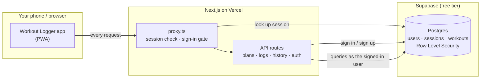

# Workout Logger

Workout Logger is a small web app for planning your training days and logging what you lift.

Set up a plan for each kind of session (upper, lower, push, pull, legs, …). Then, on training day, pick the plan and log each exercise: sets, reps, weight and any notes. The log starts from what you did the last time you ran that plan, so you only change what went up:

> **Upper A** · Wed 14 Oct
> Bench press · 3 × 5 · last time 80 kg × 5, 5, 4
> ✓ 80 kg × 5 ✓ 80 kg × 5 ✓ 80 kg × 5
> Pull-up · 3 × 8 · bodyweight
> ✓ 8 ✓ 8 ✓ 7

That way you always know what to beat, and your progress is there to look back on.

## Features

- **Multiple workout plans**, one per training day.
- **Daily logs** of sets, reps, weights and notes for every exercise, pre-filled from the last session of the same plan and saved as you type.
- **History** of your training: a workout calendar and weekly streak, personal records, and a progress chart (estimated 1RM, top set or reps) for every exercise.
- **Your own account.** Sign in with your email and a password; your plans and logs are yours alone.
- **Installable.** Add it to your home screen and use it like a native app at the gym.

## How it works



1. You sign in with your email and password (hashed with scrypt, stored in the `users` table). That starts a 30-day session: a random token in an HTTP-only cookie, with only its hash stored in the `sessions` table. `proxy.ts` checks the session on every request, extends it while you keep using the app, and sends signed-out visitors to the sign-in page.
2. The API routes check the session, then run their queries in a transaction that acts as the signed-in user (the `authenticated` role, with your id where `auth.uid()` reads it). They never query workout data with the connection's own admin rights. Row Level Security policies in the database decide which rows each user can read or change, so one user can't see another's plans or logs even if an API route has a bug.
3. Starting a workout copies the plan's exercises and the sets from that plan's last session into a new log, in a single database function. After that, the day view saves your edits automatically.

## Contributing

**Stack:** Next.js 16 (App Router, Cache Components) · React 19 · TypeScript · Tailwind CSS v4 · Postgres (hosted on Supabase, queried with `postgres`) · `zod` · `pino` · pnpm 11. The app is hosted on Vercel, and database migrations run through GitHub Actions.

**Prerequisites:** Node.js 22.18+ (`pnpm set-password` runs TypeScript directly), pnpm 11 (`corepack enable`), and Docker for the local Supabase stack.

```bash
pnpm install
cp .env.example .env.local     # set DATABASE_URL (the local one is in the file)
pnpm exec supabase start       # local Postgres + Studio (Docker)
pnpm exec supabase db reset    # apply migrations + seed
pnpm dev                       # http://localhost:3000
```

Open the app and create an account with any email address and a password of 8+ characters.

The local Supabase credentials, the migration workflow and CI deploys are described in [`supabase/README.md`](supabase/README.md).

| Script | Does |
| --- | --- |
| `pnpm dev` | dev server |
| `pnpm build` / `pnpm start` | production build / serve it |
| `pnpm lint` | ESLint |
| `pnpm set-password <email>` | set or reset an account's password (there's no email, so this is how a forgotten password gets reset) |
| `pnpm test:db` | database tests (pgTAP, in `supabase/tests/`), e.g. that users can't see each other's data; needs the local stack running |

**Deploying your own instance (free):** create a free Supabase project and import the repo into Vercel (Hobby plan), with `DATABASE_URL` set to the project's Transaction pooler connection string (Dashboard → Connect, port 6543). No Auth or email setup is needed. Add `SUPABASE_ACCESS_TOKEN`, `SUPABASE_PROJECT_ID` and `SUPABASE_DB_PASSWORD` as GitHub Action secrets so migrations apply on merge to `main`.
